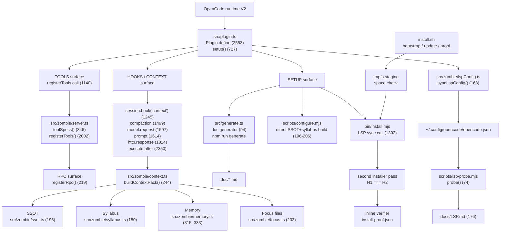

# ZombieCoder Architecture Map

একজন নতুন agent-এর জন্য এক পাতা: কোথা থেকে শুরু, কোন ফাইল কী করে, আর কোথায় হাত দিলে কী বদলায়। প্রতিটি `file:line` এই repo-তে `grep -n` দিয়ে যাচাই করা; না পারলে `UNVERIFIED` লেখা আছে।

> Repo: `https://github.com/azurebluezone/adapter` (`main`)। Line anchor code বদলালে সরে যেতে পারে — কাজ শুরুর আগে `grep -n` দিয়ে আবার মিলিয়ে নাও। Mermaid render এই environment-এ `NOT_TESTED` (block শুধু syntax-checked)।

## ১. Runtime chain



নোট: `src/generate.ts` persona বানায় না — এটি `doc/Identity Specification.md`, `doc/Agent Architecture.md` ইত্যাদি markdown generator (`src/generate.ts:94`, `package.json:17`)। Persona-র সত্যিকারের source `src/roster.ts`; runtime agent markdown লেখে `src/roster.ts:247` (`agentMarkdown`) আর `src/plugin.ts:683` (`setup`). LSP config-এর default path `~/.config/opencode/opencode.json` (`scripts/lsp-probe.mjs:41-46`); installer ওখানেই `lsp` block merge করে (`bin/install.mjs:1302`).

`install.sh` install logic duplicate করে না: এটি source staging, integrity, দুই installer pass আর inline verifier চালায়; আসল pipeline সবসময় `bin/install.mjs`। Proof-এর ১৭টি check হলো integrity, staging budget, config JSON, entrypoint, source hash fidelity, single loader, ৯ agent, consent `ask`, dependencies, audit, LSP config, LSP initialize, live `/api/plugin`, live MCP connectivity (`/api/mcp`), idempotence `H1 === H2`, space delta এবং staging cleanup।

## ২. Tool map — ২৮টি tool

গণনা প্রমাণ: `toolSpecs()` runtime-এ ২৮টি spec দেয় (`test/plugin.test.ts:342` → `assert.equal(fake.tools.length, 28)`) এবং `test/wiring.test.ts:126` surface-এ ২৮টি নাম মেলায়। নিচের প্রতিটি নাম `src/zombie/server.ts`-এর `name:` লাইন থেকে নেওয়া।

| # | Tool | কাজ (এক লাইন) | Impl `file:line` | Test | Docs |
|---|---|---|---|---|---|
| 1 | `get_working_directory` | project root ও `.zombiecoder` layout দেখায় | `src/zombie/server.ts:388` | `test/plugin.test.ts` | `README.md:1067` |
| 2 | `read_ssot` | generated SSOT markdown পড়ে | `src/zombie/server.ts:403` | `test/plugin.test.ts`, `test/wiring.test.ts` | `README.md:1065` |
| 3 | `read_syllabus` | append-only syllabus পড়ে | `src/zombie/server.ts:417` | `test/wiring.test.ts` | `README.md:1066` |
| 4 | `append_syllabus` | নতুন lesson append করে | `src/zombie/server.ts:430` | `test/plugin.test.ts`, `test/agents.test.ts` | `README.md:1072` |
| 5 | `goal_contract` | expected outcome + check; এক session-এ একটাই open, close-এ নিজেই check চালায় | `src/zombie/server.ts:462` | `test/plugin.test.ts`, `test/goalContract.test.ts`, `test/route.test.ts` | `README.md:1075`, `docs/AGENT-HANDOFF.md:23` |
| 6 | `project_fingerprint` | live project scan, কোনো file লেখে না | `src/zombie/server.ts:1068` | `test/plugin.test.ts`, `test/wiring.test.ts` | `README.md:1068` |
| 7 | `design_sketch` | নতুন screen/flow-এর ঐচ্ছিক `sketch.md` + `design.json` | `src/zombie/server.ts:1076` | `test/design.test.ts`, `test/plugin.test.ts` | `README.md:1079` |
| 8 | `design_review` | markup/CSS-এ `file:line` a11y finding | `src/zombie/server.ts:1094` | `test/design.test.ts`, `test/plugin.test.ts` | `README.md:1080` |
| 9 | `project_onboarding` | প্রথম input-এ docs/code gap syllabus-এ লেখে | `src/zombie/server.ts:1107` | `test/plugin.test.ts`, `test/wiring.test.ts` | `README.md:1076` |
| 10 | `project_investigation` | bounded investigation package syllabus-এ dedupe করে | `src/zombie/server.ts:1131` | `test/investigation.test.ts`, `test/plugin.test.ts` | `README.md:1078` |
| 11 | `context_status` | SSOT/syllabus/memory/focus pack-এর `uiLine` দেয় | `src/zombie/server.ts:1148` | `test/plugin.test.ts`, `test/wiring.test.ts` | `README.md:1069` |
| 12 | `subagent_context` | subagent launch-এর bounded envelope render করে | `src/zombie/server.ts:1199` | `test/plugin.test.ts` | `—` |
| 13 | `tool_result_read` | archived tool result পড়ে | `src/zombie/server.ts:1229` | `test/plugin.test.ts`, `test/wiring.test.ts` | `—` |
| 14 | `evidence_gate` | claim/response evidence যাচাই করে | `src/zombie/server.ts:1252` | `test/plugin.test.ts` | `README.md:1070` |
| 15 | `verify_real` | real input+artifact hash করে provenance লেখে | `src/zombie/server.ts:1338` | `test/plugin.test.ts` | `README.md:1077` |
| 16 | `memory_archive` | archived session message পড়ে | `src/zombie/server.ts:1466` | `test/plugin.test.ts`, `test/wiring.test.ts` | `README.md:1071` |
| 17 | `syntax_check` | syntax fallback (LSP নয়) | `src/zombie/server.ts:1490` | `test/plugin.test.ts`, `test/lsp.test.ts` | `README.md:1073` |
| 18 | `symbol_overview` | real LSP symbol outline | `src/zombie/server.ts:1512` | `test/symbols.test.ts`, `test/regressions.test.ts` | `—` |
| 19 | `find_symbols` | real LSP symbol search | `src/zombie/server.ts:1535` | `test/symbols.test.ts`, `test/regressions.test.ts` | `—` |
| 20 | `find_references` | real LSP references | `src/zombie/server.ts:1560` | `test/symbols.test.ts`, `test/regressions.test.ts` | `—` |
| 21 | `diagnostics_for_file` | real LSP diagnostics | `src/zombie/server.ts:1585` | `test/symbols.test.ts`, `test/regressions.test.ts` | `—` |
| 22 | `skill_catalog` | shared skill list/install/auto | `src/zombie/server.ts:1608` | `test/skillCatalog.test.ts`, `test/capabilities.test.ts` | `README.md:1074` |
| 23 | `agent_modes` | V2 mode list + validated switch plan | `src/zombie/server.ts:1642` | `test/plugin.test.ts` | `README.md:1081` |
| 24 | `reload` | agents/skills/providers/tools door reload | `src/zombie/server.ts:1697` | `test/tools.test.ts` | `README.md:1082` |
| 25 | `http_probe` | HTTP status/header/body hash, secret redact | `src/zombie/server.ts:1734` | `test/tools.test.ts` | `README.md:1083` |
| 26 | `patch_preview` | one exact-string replace dry-run; apply-এ backup | `src/zombie/server.ts:1799` | `test/tools.test.ts` | `README.md:1084` |
| 27 | `env_get` | env var আছে কিনা, value ছাড়া | `src/zombie/server.ts:1858` | `test/tools.test.ts`, `test/wiring.test.ts` | `README.md:1085` |
| 28 | `service_probe` | TCP connect বা HTTP GET probe | `src/zombie/server.ts:1882` | `test/tools.test.ts` | `README.md:1086` |

## ৩. কোথায় কী এডিট করব

| চাই | ফাইল | Anchor | কেন |
|---|---|---|---|
| Persona, shared rules, voice | `src/roster.ts` | `SHARED_RULES:5`, `SHARED_PERSONA:170` | সব agent-এর common instruction এখান থেকেই আসে |
| Tone contract + prompt render | `src/agents/base.ts` | `renderAgentPrompt:48` | প্রতিটি prompt-এ বন্ধুসুলভ/দুষ্টামি/বরিশালি টোন + role + evidence |
| Agent-এর persona merge | `src/roster.ts` | `mergeAgentPersona:112` | agent-specific + shared block জোড়ে |
| Agent markdown render | `src/roster.ts` | `agentMarkdown:247` | runtime `.md` persona-র আসল generator |
| Agent config render | `src/roster.ts` | `renderAgentsConfig:209` | `opencode.json` agent block |
| Doc markdown generator | `src/generate.ts` | `main:94` | `doc/*.md` build artifact; persona নয় |
| SSOT | `src/zombie/ssot.ts` | `writeSsot:196` | live scan → `SSOT.md` |
| Syllabus | `src/zombie/syllabus.ts` | `appendSyllabus:180` | append-only lesson |
| Memory / archive | `src/zombie/memory.ts` | `archiveSessionSnapshot:315`, `readArchive:333` | session archive ও read |
| Context pack | `src/zombie/context.ts` | `buildContextPack:244` | bounded SSOT+syllabus+focus+memory |
| Focus file resolution | `src/zombie/focus.ts` | `resolveFocus:203` | user message → target files |
| Footprint scan completeness | `src/zombie/scan.ts` | `scanProject:176`, `DEFAULT_MAX_INDEXED_FILES` | totalFiles অক্যাপড; index বড় হলে `indexTruncated` |
| Footprint rendering | `src/zombie/syllabus.ts` | `renderSyllabusSeed:46`, `ensureSyllabus:153` | নতুন project-এর §2 map + `File index … (complete/truncated)` |
| Goal contract | `src/zombie/goalContract.ts` | `runCheck:215` | contract parse/match/check |
| Contract hardening | `src/zombie/goalContract.ts` | `validateCheck`, `trivialExpected` | no-op check আর status-word expected reject করে |
| Shell write/ledger guard | `src/zombie/shellGuard.ts` | `analyzeShell:209`, `ledgerTarget:220` | quoted text বাদ দিয়ে redirect/write verb parse করে ledger রক্ষা করে |
| Persona enforcement + delegation | `src/plugin.ts` | `mergeAgentPersona` call, `execute.before` guard | persona marker check, unknown agent fail-closed, সর্বোচ্চ ৪ specialist |
| Tools | `src/zombie/server.ts` | `toolSpecs:346` | ২৮টি tool-এর একমাত্র registry |
| Plugin wiring / hooks | `src/plugin.ts` | `setup:683`, `export default:2204` | surface registration ও hook lifecycle |
| Bootstrap / update / proof | `install.sh` | staging + two installer passes + inline verifier | `PROOF PASS`/`PROOF FAIL`, `$TARGET/zombiecoder/install-proof.json` |
| Setup / install | `bin/install.mjs` | `renderAgentsConfig` call `:1224`, LSP sync `:1302`, `retireLegacyDuplicateEntry:734` | global/project install; duplicate loader retire with backup |
| Project configure | `scripts/configure.mjs` | direct build `:196-206` | OpenCode বন্ধ থাকলেও SSOT+syllabus |
| LSP config | `src/zombie/lspConfig.ts` | `LSP_SERVERS:52`, `syncLspConfig:168` | server list + `opencode.json` merge |
| LSP probe | `scripts/lsp-probe.mjs` | `probe:74`, config read `:176` | real JSON-RPC initialize |
| LSP diagnostics | `scripts/lsp-diagnostics.mjs` | `textDocument/didOpen` + `publishDiagnostics` | real server diagnostic; file on disk untouched |
| Tests | `test/*.test.ts` | — | `npm test` (`package.json:19`) |
| Docs | `docs/*.md` | — | LSP: `docs/LSP.md:176`; handoff: `docs/AGENT-HANDOFF.md:23` |

## ৪. Agent flow — পড়া থেকে প্রমাণ

1. **SSOT** — `read_ssot`; project structure ও shared rules আগে দেখো।
2. **Syllabus** — `read_syllabus`; আগের lesson ও footprint বাদ দিও না।
3. **Memory** — দরকার হলে `memory_archive`; পুরো history টানো নিষেধ।
4. **Focus** — `context_status`-এ `message` দাও; `src/zombie/focus.ts:203` target file list দেয়।
5. **Act** — নির্দিষ্ট file/symbol পড়ে smallest correct diff; irreversible কাজের আগে backup (`patch_preview:1799`)।
6. **Verify** — আসল command/output; `evidence_gate:1252` বা `verify_real:1338`; `goal_contract close:462` নিজেই check চালায়, agent-এর exitCode claim বিশ্বাস করে না।

| Gate | কোথায় | কখন |
|---|---|---|
| `goal_contract` | `src/zombie/server.ts:462` | প্রথম write/edit-এর আগে `open`; শেষে `close` |
| `context_status` | `src/zombie/server.ts:1148` | substantive কাজের শুরুর দৃশ্যমান লাইন |
| Pre-work gate text | `src/zombie/context.ts:444` | pack-এ inject হওয়া gate instruction |
| Response gate | `src/plugin.ts:1879` | `http.response` hook, unproven claim আটকায় |
| Tool failure breaker | `src/plugin.ts:2466` | `execute.after`, তিন failure-এ escalation |

## ৫. Known boundaries

| Boundary | সত্যি অবস্থা | প্রমাণ |
|---|---|---|
| `usage_report` | implement করা নেই; `src/`, `test/`, `docs/`, installer-এ নামও নেই (এই map বাদে) | `grep -rn "usage_report" src docs test bin scripts README.md --exclude=architecture-map.md \| wc -l` → 0 |
| `eval_run` | implement করা নেই; `src/`, `test/`, `docs/`, installer-এ নামও নেই (এই map বাদে) | `grep -rn "eval_run" src docs test bin scripts README.md --exclude=architecture-map.md \| wc -l` → 0 |
| Editor LSP diagnostics | `NOT_TESTED` — app restart + real `.ts` file open + `ps`-এ LSP child দেখা, তারপর `END_TO_END_TESTED` | `docs/LSP.md:345` |
| LSP direct probe | এই session-এ `npm run lsp:probe -- --compact --root "$PWD"` → exit 0, 7/7 server `ok: true` (`LIVE_PROBE_PASSED`); editor diagnostic আলাদা স্তর | `scripts/lsp-probe.mjs:74`, `docs/LSP.md:204` |
| `syntax_check` | LSP নয়; `node --check`, `tsc`, `py_compile`, `bash -n`, `php -l` fallback | `docs/LSP.md:279`, `src/zombie/lsp.ts:328` |

## ৬. Machine-readable

```yaml
# impl = spec `name:` line in src/zombie/server.ts
tools:
  get_working_directory: { impl: "src/zombie/server.ts:388", tests: ["test/plugin.test.ts"], docs: ["README.md:1067"] }
  read_ssot:             { impl: "src/zombie/server.ts:403", tests: ["test/plugin.test.ts", "test/wiring.test.ts"], docs: ["README.md:1065"] }
  read_syllabus:         { impl: "src/zombie/server.ts:417", tests: ["test/wiring.test.ts"], docs: ["README.md:1066"] }
  append_syllabus:       { impl: "src/zombie/server.ts:430", tests: ["test/plugin.test.ts", "test/agents.test.ts"], docs: ["README.md:1072"] }
  goal_contract:         { impl: "src/zombie/server.ts:462", tests: ["test/plugin.test.ts", "test/goalContract.test.ts", "test/route.test.ts"], docs: ["README.md:1075", "docs/AGENT-HANDOFF.md:23"] }
  project_fingerprint:   { impl: "src/zombie/server.ts:1068", tests: ["test/plugin.test.ts", "test/wiring.test.ts"], docs: ["README.md:1068"] }
  design_sketch:         { impl: "src/zombie/server.ts:1076", tests: ["test/design.test.ts", "test/plugin.test.ts"], docs: ["README.md:1079"] }
  design_review:         { impl: "src/zombie/server.ts:1094", tests: ["test/design.test.ts", "test/plugin.test.ts"], docs: ["README.md:1080"] }
  project_onboarding:    { impl: "src/zombie/server.ts:1107", tests: ["test/plugin.test.ts", "test/wiring.test.ts"], docs: ["README.md:1076"] }
  project_investigation: { impl: "src/zombie/server.ts:1131", tests: ["test/investigation.test.ts", "test/plugin.test.ts"], docs: ["README.md:1078"] }
  context_status:        { impl: "src/zombie/server.ts:1148", tests: ["test/plugin.test.ts", "test/wiring.test.ts"], docs: ["README.md:1069"] }
  subagent_context:      { impl: "src/zombie/server.ts:1199", tests: ["test/plugin.test.ts"], docs: [] }
  tool_result_read:      { impl: "src/zombie/server.ts:1229", tests: ["test/plugin.test.ts", "test/wiring.test.ts"], docs: [] }
  evidence_gate:         { impl: "src/zombie/server.ts:1252", tests: ["test/plugin.test.ts"], docs: ["README.md:1070"] }
  verify_real:           { impl: "src/zombie/server.ts:1338", tests: ["test/plugin.test.ts"], docs: ["README.md:1077"] }
  memory_archive:        { impl: "src/zombie/server.ts:1466", tests: ["test/plugin.test.ts", "test/wiring.test.ts"], docs: ["README.md:1071"] }
  syntax_check:          { impl: "src/zombie/server.ts:1490", tests: ["test/plugin.test.ts", "test/lsp.test.ts"], docs: ["README.md:1073", "docs/LSP.md:279"] }
  symbol_overview:       { impl: "src/zombie/server.ts:1512", tests: ["test/symbols.test.ts", "test/regressions.test.ts"], docs: [] }
  find_symbols:          { impl: "src/zombie/server.ts:1535", tests: ["test/symbols.test.ts", "test/regressions.test.ts"], docs: [] }
  find_references:       { impl: "src/zombie/server.ts:1560", tests: ["test/symbols.test.ts", "test/regressions.test.ts"], docs: [] }
  diagnostics_for_file:  { impl: "src/zombie/server.ts:1585", tests: ["test/symbols.test.ts", "test/regressions.test.ts"], docs: [] }
  skill_catalog:         { impl: "src/zombie/server.ts:1608", tests: ["test/skillCatalog.test.ts", "test/capabilities.test.ts"], docs: ["README.md:1074"] }
  agent_modes:           { impl: "src/zombie/server.ts:1642", tests: ["test/plugin.test.ts"], docs: ["README.md:1081"] }
  reload:                { impl: "src/zombie/server.ts:1697", tests: ["test/tools.test.ts"], docs: ["README.md:1082"] }
  http_probe:            { impl: "src/zombie/server.ts:1734", tests: ["test/tools.test.ts"], docs: ["README.md:1083"] }
  patch_preview:         { impl: "src/zombie/server.ts:1799", tests: ["test/tools.test.ts"], docs: ["README.md:1084"] }
  env_get:               { impl: "src/zombie/server.ts:1858", tests: ["test/tools.test.ts", "test/wiring.test.ts"], docs: ["README.md:1085"] }
  service_probe:         { impl: "src/zombie/server.ts:1882", tests: ["test/tools.test.ts"], docs: ["README.md:1086"] }
```

`docs: []` মানে dedicated doc section নেই; source description-ই তখন documentation।
